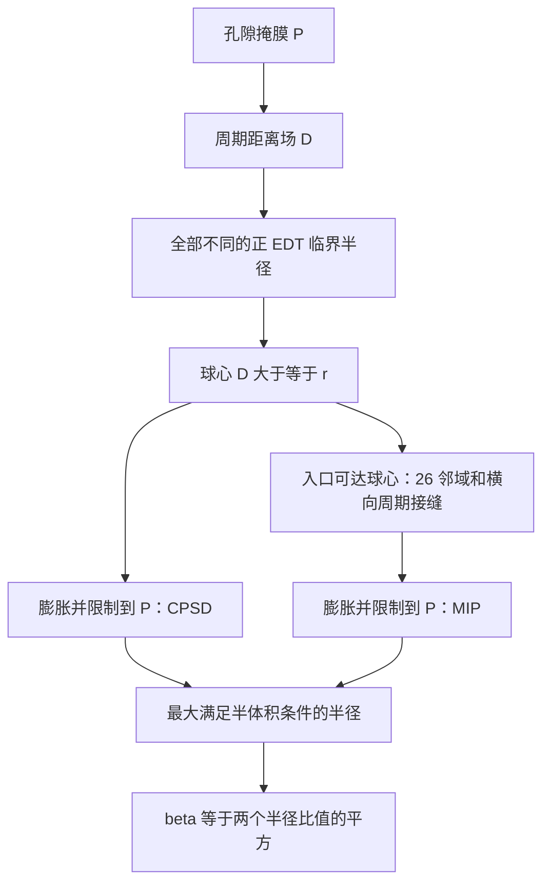

# 瓶颈度算法：参考文献核对后的 v2 实现

## 依据与范围

本实现依据以下原始论文，不是作者 Java/MATLAB 源码的移植，也未宣称与 Xlib 逐位一致。

| 依据 | 核对内容 | 本项目采用方式 |
|---|---|---|
| [Münch & Holzer (2008)](https://doi.org/10.1111/j.1551-2916.2008.02736.x)，附录 A.2–A.3 | 距离场阈值选球心；入口区域生长；再膨胀并限制到孔隙相 | CPSD/MIP 共用同一距离场；MIP 连通性作用于膨胀前球心 |
| [Holzer et al. (2013)](https://doi.org/10.1007/s10853-012-6968-z)，图 4、6–10 | 50% 体积分位半径；入口方向和样本厚度对结果的影响 | 保留全部孔隙体积的共同阈值；支持 xyz 及 low/high 六个入口 |
| [Neumann et al. (2019)](https://doi.org/10.1111/sjos.12375)，§2.2.2、§2.3.2、§5 | 用满足半体积条件的半径上确界定义指标；离散模拟采用 26 邻域 | 取最大满足阈值的临界半径；默认 26 邻域，支持 6/18 邻域敏感性分析 |
| [Prifling et al. (2021)](https://doi.org/10.3389/fmats.2021.786502)，§2.4 | 本任务目标定义及周期边界 | 几何 xyz 周期；侵入只横向周期；默认从 x 的低值面侵入 |

注意：2013 年文章区分几何收缩因子 β 和输运意义的 δ。本项目采用目标论文 2021 年的 β=(r_min/r_max)²，不把 2013 年的 δ 拟合关系混入该指标。

Neumann 的 §5 提到对离散开运算集合做连通分量计算，而 §2.2.2 的形式定义是对侵蚀集合的入口可达部分做膨胀。本实现明确采用后者，且与 2008 年附录 A.3 一致；26 邻域是借鉴其离散邻域约定，并不声称完整复现该文 §5 的程序。

## 定义和核心步骤

令 P 为孔隙掩膜，ε=|P|/|Ω|，D 为孔隙点到固相的周期欧氏距离。长度计算先使用体素单位，输出时乘体素边长 h。

1. 对每个半径 r，取球心 E(r)={p∈P:D(p)≥r}。
2. CPSD：将 E(r) 按半径 r 膨胀，再与 P 相交，统计体积占整个样本的比例。
3. MIP：在 E(r) 内标记连通分量，合并横向周期接缝，保留与指定入口平面相连的球心；随后膨胀并与 P 相交。
4. r_max=max{r:2|CPSD覆盖区(r)|≥|P|}；r_min 使用 MIP 覆盖区作相同计算。
5. β=(r_min/r_max)²。β 越小，瓶颈效应越强。

连通判断必须先于膨胀，否则球心无法通过窄喉的孔腔可能被错误视为可侵入。MIP 不要求通到出口；分母也不能改成入口可达孔隙体积。



## v2 相对旧版的修订

### 完整临界半径代替整数步长

旧版只计算 r=0,1,2,…，例如真实数字距离为 √2 的孔体会被降为 1。v2 计算 D 在孔隙中的全部不同正值，包含 √2、√3、√5 等，并附上 r=0 和一个空覆盖终点。

这是针对当前数字模型的改进：在相邻两个 EDT 值之间，球心集合和入口可达球心集合不变，膨胀覆盖体积随 r 不减；因此最大满足阈值的半径一定可在某个 EDT 临界值处取得。无需线性插值，也无需假设所有数字开运算严格单调。采样值连接成曲线只用于展示，不能把连线当作已计算的中间半径。

临界半径扫描是本项目从阈值算法推导的实现优化，不是声称参考文献直接给出的源码。它消除了额外的整数半径舍入，但不消除图像分辨率、体素边界或邻域选择的误差。

### 数字球约定

球心条件 D≥r；膨胀使用到球心集合的距离≤r，并与原孔隙相相交，对应附录的球域覆盖与排除固相步骤。旧版使用距离<r，会遗漏恰好落在半径上的孔隙体素。连续空间中的边界差异体积为零，但在数字图像中必须明确约定；v2 版本号记录这一变化。

### 邻域和方向

默认 26 邻域，支持 6/18/26。周期接缝合并同时覆盖面、棱、角连接；仅合并对面相同坐标不足以实现 26 邻域。侵入方向绝不首尾周期连通。

可以选择 x/y/z 与 low/high，支持比较六个侵入方向。默认仍为 x-low；如果要和项目原有 z 方向曲折度比较，请指定 z。这里只提供方向选择，不自动平均不同方向的 β。

### 计算开销

完整距离场仍使用各周期轴两倍尺寸的扩展。对半径 r 的膨胀，仅需每侧 ceil(r) 的周期填充，并以半周期为上限；大于 r 的距离返回 inf。这样保留阈值范围内的精确结果，减少工作数组。无入口球心时跳过 MIP 距离变换；连通分量使用按大小合并的并查集和整数查表。

更多临界半径可能增加扫描次数，因此不保证 v2 对任何结构都比旧版快。基准文件 `constrictivity_benchmark.json` 比较的是同一 v2 算法使用完整填充与半径限制填充的耗时，结果曲线完全相同；不将这个加速比当作 v1/v2 全算法比较。

## 输入、异常情况和局限

- 三维等边体素；体素边长必须有限且为正。数组轴顺序为 x,y,z。
- 集成流程仅把标签 0 当作电解液孔隙，CBD 标签 2 不属于孔隙；独立 API 可指定其他相标签。
- 无孔隙或无固相界面：半径和 β 为 None，导出为 null/N/A，并记录状态。
- 入口可达体积不足全部孔隙体积的一半：r_min=0、β=0，状态 `insufficient_inlet_access`。
- 几何仍采用目标论文的周期样本假设；实际非周期样本需先评估拼接影响。支持反向入口并不等于已实现非周期外边界模型。
- 26 邻域允许角点连接；对低分辨率结构应与 6/18 邻域比较，不把一种邻域宣称为连续几何的精确答案。
- 样本尺寸/入口效应仍存在；方向选择不替代代表体积检验。

## 文件和导出

- `../constrictivity.py`：旧导入路径的兼容入口，不包含独立算法实现。
- `../electrode_structure_factors.py`：瓶颈度核心算法、结果对象及辅助函数；单文件、批处理和 JSON/Excel 导出。
- `../electrode-kit.py`：总流程入口，同样支持新参数。
- `../tests/test_constrictivity.py`：独立 BFS、球覆盖枚举、周期距离和命令行导出验证。

JSON 保留 `constrictivity_beta`、`r_min_um`、`r_max_um`。`constrictivity_details` 记录曲线、轴、入口、邻域、方法版本 `edt_critical_radii_closed_dilation_v2` 和 `radius_sampling=all_positive_edt_values`。由于不再等间距采样，`radius_step_um` 改为 null。

现有六项训练标签和模型输出维度未改变。修改仅在外层主源码，嵌套副本未同步。历史指标文件不会因源码更新自动变化；旧版和 v2 指标可能不同，不应不加区分地混合使用。

## 运行

在 E:/chem 下执行（替换示例路径）：

```powershell
# 单文件；与原有 z 方向曲折度对齐
.\Enviroment\Scripts\python.exe .\electrode_reconstructor\electrode_structure_factors.py PATH_TO_PHASE_SLICES.txt --voxel-size-um 0.5 --constrictivity-axis z --constrictivity-connectivity 26 --constrictivity-inlet low

# 批量重算；将更新指定目录中的指标文件
.\Enviroment\Scripts\python.exe .\electrode_reconstructor\electrode_structure_factors.py --batch-root PATH_TO_DATA --batch-output-format both --constrictivity-axis x

# 测试
.\Enviroment\Scripts\python.exe -B -m unittest discover -s .\electrode_reconstructor\tests -v
```

总流程 `electrode-kit.py` 接受同名三个参数；若输出已经存在，还需 `--recompute-existing-factors` 才会重算。

```python
from electrode_structure_factors import compute_constrictivity
result = compute_constrictivity(
    phase_labels, voxel_size_um=0.5,
    axis=2, connectivity=26, inlet_side="high",
)
print(result.constrictivity_beta, result.r_min_um, result.r_max_um)
```

## 验证

15 项单元/集成测试包含：直通孔与窄喉；缩放与轴置换；两种退化相；封闭孔和半体积恰好相等；6/18/26 邻域与独立 BFS 对比；跨周期棱角连接；有限填充与完整 EDT 一致；CPSD/MIP 与全配对距离及球覆盖枚举一致；√2 临界半径；反向入口等价性；实际批处理 CLI 的 JSON/Excel 输出。

`constrictivity_demo.png` 是合成结构示例而非论文数据。代码尚未与作者的 Java/Xlib 程序做逐位数值对标。


本次本机基准：64³ 体素、随机孔隙概率 0.7、固定种子 20261013、各运行三次。完整周期填充中位数 5.918 秒，半径限制填充 1.794 秒，约 3.30 倍；两种计算的 CPSD/MIP 数组完全一致。时间随硬件和结构而变，不能外推为所有样本的加速比。

还对 `Structure_Data/test/20260703_02/electrode_test_0001_phase_slices.txt` 做了只读验证：64³ 体素、h=0.5 μm、x-low、26 邻域，得到 r_min=1.11803398875 μm、r_max=1.22474487139 μm、β=0.83333333333，状态 ok；未覆盖已有指标文件。总流程命令行帮助、批处理 CLI、语法解析与 git diff --check 均通过。
